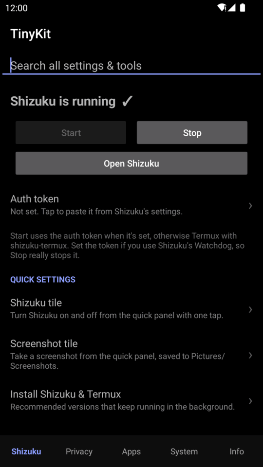
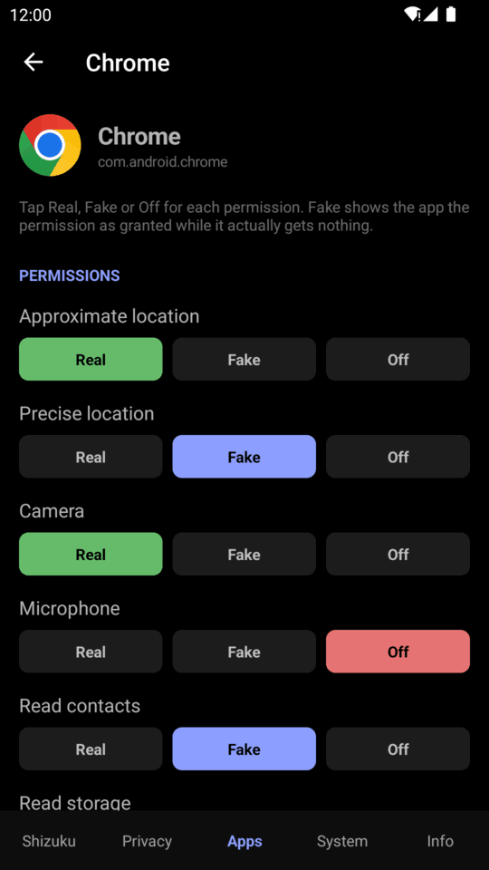
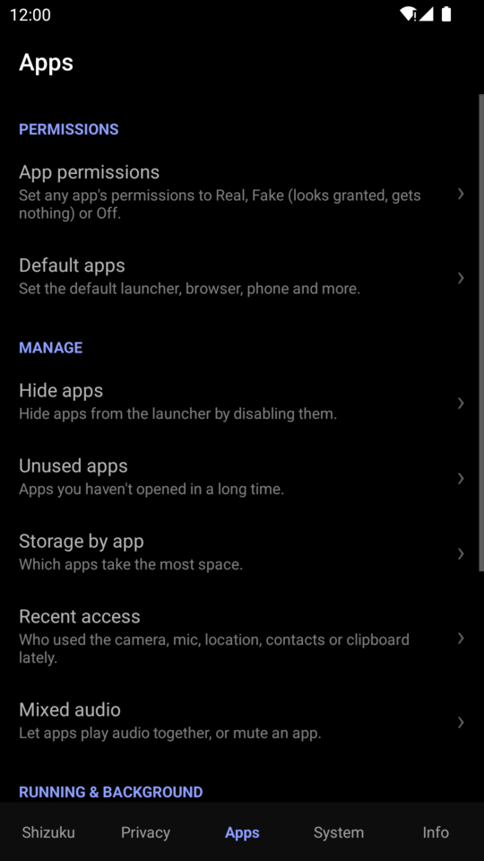
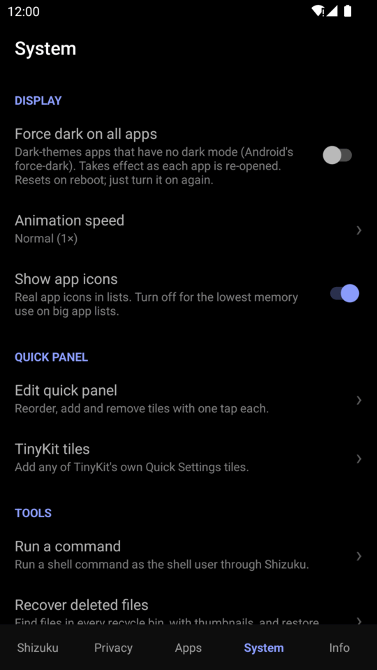
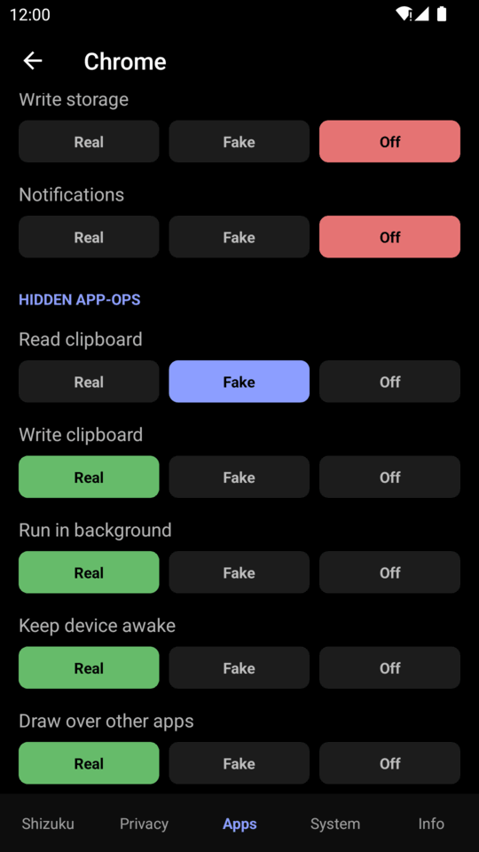

<div align="center">


# TinyKit

**Useful Android tweaks in one clean menu. No root, powered by [Shizuku](https://shizuku.rikka.app/).**

[](https://github.com/Order52/tinykit/releases/latest)
[](https://github.com/Order52/tinykit/releases)
[](#requirements)
[](https://github.com/Order52/tinykit/releases/latest)
[](LICENSE)

[**Download the latest APK**](https://github.com/Order52/tinykit/releases/latest) ·
[Fake permissions](#-fake-permissions) ·
[Features](#features) ·
[Documentation](docs/README.md)

<br>






</div>

---

TinyKit puts dozens of hidden Android settings, privacy controls and system tools in one
place: fake permissions, deleted-file recovery, Quick Settings tiles
and more. It uses [Shizuku](https://shizuku.rikka.app/) to get shell-level access without
rooting your phone.

- **No root.** Everything runs through Shizuku with ADB-level permissions.
- **Nothing in the background.** No services, no wake-locks. TinyKit only works while it is
  open, or when you tap one of its tiles or its widget.
- **No ads, no analytics, no tracking.** It only goes online when you check for updates
  (GitHub, by tap or optionally when TinyKit opens) or open Network info (public IP lookup).
- **Small.** About 110 KB, with a single dependency (the Shizuku API).
- **Reversible.** Every change is a standard system setting or app-op, and you undo it from
  the same screen.

The interface uses a pure black (AMOLED) theme and a bottom bar with five sections:
**Shizuku · Privacy · Apps · System · Info**. A search bar on the home screen finds any tool.

## Contents

- [🎭 Fake permissions](#-fake-permissions)
- [Features](#features)
- [Requirements](#requirements)
- [Installation](#installation)
- [How it works](#how-it-works)
- [Documentation](#documentation)
- [Building from source](#building-from-source)
- [Contributing](#contributing)
- [License](#license)

## 🎭 Fake permissions

**Give an app the permission it insists on, without giving it your data.**

Some apps refuse to work until you grant a permission they don't need. Android only lets you
**allow** (the app gets your data) or **deny** (the app knows, and complains). TinyKit adds a
third choice:

<table>
<tr>
<td width="56%" valign="top">

| | App sees | App gets |
| --- | --- | --- |
| 🟩 **Real** | Granted | Your real data |
| 🟦 **Fake** | **Granted** | **Nothing**: empty contacts, no location, silent mic |
| 🟥 **Off** | Denied | Nothing |

**How:** *Fake* grants the runtime permission, then sets the matching
[app-op](https://developer.android.com/reference/android/app/AppOpsManager) to `ignore`:

```sh
pm grant <pkg> android.permission.READ_CONTACTS
appops set --uid <pkg> READ_CONTACTS ignore
```

The app's permission check passes, but Android quietly returns empty results instead of
throwing an error, so the app carries on as if you simply had no contacts.

- Works for **location, camera, microphone, contacts, calendar, call log, phone, SMS,
  storage, body sensors, physical activity and notifications**.
- Also controls **hidden app-ops** that Android's Settings never shows: clipboard read and
  write, background running, wake locks, overlays, usage access, all-files access,
  foreground services and vibration.
- Survives reboots and needs nothing running. Tap **Real** to undo.

**[Read the full guide →](docs/fake-permissions.md)**

</td>
<td width="44%" align="center" valign="top">

<br><sub>Per-app permissions</sub>
<br><br>

<br><sub>Hidden app-ops</sub>
</td>
</tr>
</table>

Find it under **Apps → App permissions**.

## Features

### Shizuku

| Tool | What it does |
| --- | --- |
| **Start / Stop Shizuku** | Starts and stops Shizuku from inside TinyKit. If you have set Shizuku's auth token (in Shizuku's settings), TinyKit talks to Shizuku directly, and Stop works with its Watchdog. Without the token, Start goes through Termux with [shizuku-termux](https://github.com/Order52/shizuku-termux), or opens Shizuku so you tap its Start button. Works with the standard Shizuku app and its forks. |
| **Search** | Find any TinyKit setting or tool from the top of the home screen. |

### Quick Settings tiles

Add any of these from **System → TinyKit tiles**. On Android 13 and newer, adding one takes a
single tap. Eight of them keep working with Shizuku stopped.
[All tiles →](docs/quick-settings-tiles.md)

| | | | |
| :---: | :---: | :---: | :---: |
| <br>Shizuku on/off | <br>Screenshot | <br>Screen record | <br>Caffeine |
| <br>Developer options | <br>USB debugging | <br>Hide dev options | <br>Sensors off |
| <br>Grayscale | <br>Extra dim | <br>Ad-block DNS | <br>Mic & camera off |
| <br>Screen timeout | <br>Clear caches | <br>Free RAM | <br>Close app |

### Privacy

| Tool | What it does |
| --- | --- |
| **Analytics & telemetry** | Turns off Huawei's User Experience Programme, its background diagnostics apps and HiCloud, and limits Google ad personalisation. Your Huawei ID sign-in is never touched. |
| **All sensors off** | Blocks every sensor, including motion, microphone and camera, for all apps. It works like the hidden *Sensors off* developer tile. |
| **Block internet per app** | Cuts chosen apps off Wi-Fi and mobile data (Android 14+) with Android's own per-app firewall, or blocks everything except the apps you allow. Nothing runs in the background: the system enforces it, and TinyKit puts it back after a restart as soon as Shizuku is running. |
| **Clipboard guard** | Stops chosen apps from reading what you copy, even while they're open. |
| **Saved Wi-Fi networks** | Lists saved networks with their passwords, with search. Share any network as a QR code. |
| **More** | Hide developer options · Ad-blocking DNS · Stop background scanning |

### Apps

| Tool | What it does |
| --- | --- |
| **App permissions** | Set each permission and hidden app-op for each app to **Real**, **Fake** or **Off**. [See above](#-fake-permissions). |
| **Default apps** | Choose the launcher, browser, phone, SMS and assistant apps, and see which app opens each file type. |
| **Hide apps** | Removes apps from the launcher, and they stop running until you restore them. |
| **Unused apps** | Lists apps by how long since you last used them. |
| **Storage by app** | Shows how much space each app uses. |
| **Recent access** | Shows which apps used the camera, microphone, location, contacts or clipboard, and when. |
| **Mixed audio** | Lets several apps play audio at once, or mutes a single app. Android's audio system enforces this, so TinyKit doesn't need to keep running. |
| **Debloater** | Removes apps your phone came with, for your user only, with a safety rating for each (Recommended, Advanced, Expert, Unsafe). Restore any of them later. |
| **Special access** | Install unknown apps, draw over apps, modify settings, all files and usage access, per app. |
| **App language** | Gives any app its own language (Android 13+). |
| **Installed with TinyKit** | The apps the installer put on, with a remove button. Stores nothing: read from Android's own records. |
| **Install APK files** | Installs `.apk`, `.apks`, `.xapk` and `.apkm` files, including apps split into parts and game data. Streams the files, installs only the parts your phone needs. |
| **More** | Running apps (stop any of them) · Stop background activity (full Restricted mode) · Keep apps alive · Back up an app as an APK |

### System

| Tool | What it does |
| --- | --- |
| **Edit quick panel** | Reorder, add and remove tiles in an editor laid out like the real panel. |
| **Run a command** | Runs any command as the shell user through Shizuku. |
| **Recover deleted files** | Searches every recycle bin and trash folder (Gallery's recycle bin, `.File_Recycle`, `.fvTrash`, Android's `.trashed-*` files, `LOST.DIR` and thumbnail caches). It shows thumbnails and copies files to `Download/TinyKit/Recovered`, leaving the originals in place. |
| **Settings backup & restore** | Saves all system settings to a file and restores them from it. |
| **Force dark on all apps** | Turns on Android's built-in force-dark for apps that have no dark mode. |
| **Animation speed** | Turns system animations off, or makes them faster or slower. |
| **Advanced reboot** | Reboots normally, or into recovery or the bootloader, or does a soft (userspace) reboot. |
| **Speed-up widget** | A home screen widget: one tap frees RAM and clears app caches without opening TinyKit, and shows how much it freed. |
| **Speed up phone** | One tap: trims and compacts app memory, closes cached apps only when memory is low, clears caches only when storage is nearly full, and starts Android's storage maintenance once a day. Nothing you're using is closed. Works without Shizuku on Android 13 and older. |
| **Clean & speed** | Clear all app caches · Optimize apps · Trim storage |
| **Network & battery** | Free hotspot · Turn off mobile data while on Wi-Fi |

### Info & logs

| Tool | What it does |
| --- | --- |
| **Device info** | Phone info · Charging info · Temperatures (every thermal sensor) · Device IDs |
| **Network info** | Shows IP addresses, Wi-Fi details, DNS and your public IP. *Open router settings* opens your default gateway's page. |
| **Usage logs** | Screen time · Battery usage · Wake-ups · Vibration log, as plain readable lists |
| **Diagnostics** | App log · Crash log · Check for updates (by tap, or optionally on start with a popup) · About |

The [feature reference](docs/features.md) lists the exact command behind every tool.

## Requirements

| | |
| --- | --- |
| **Android** | 7.0 (API 24) or newer |
| **Shizuku** | [thedjchi's fork](https://github.com/thedjchi/Shizuku/releases/latest) (recommended) or the [original](https://shizuku.rikka.app/download/) |
| **Termux** *(optional)* | Only needed to start Shizuku with the **Start Shizuku** button: install [Termux](https://termux.dev/) with [shizuku-termux](https://github.com/Order52/shizuku-termux), and the first time, allow *Run commands in Termux environment* |

## Installation

1. Install and start [Shizuku](#requirements).
2. Download `TinyKit-<version>.apk` from the [latest release](https://github.com/Order52/tinykit/releases/latest)
   and install it.
3. Open TinyKit and tap **Allow** when it asks for Shizuku access.

The [getting started guide](docs/getting-started.md) covers each way to start Shizuku.

## How it works

Shizuku runs a small process with ADB (`shell` user) privileges, and TinyKit sends commands to
it through the Shizuku API. Every tool is a standard Android mechanism, such as:

- **System settings** (`settings put global|secure|system …`)
- **App-ops** (`appops set …`)
- **Package manager** (`pm grant`, `pm revoke`, `pm disable-user`, …)
- **System services** (`cmd role`, `cmd sensor_privacy`, `cmd statusbar`, `dumpsys …`, `svc power …`)

TinyKit doesn't patch the system or modify system files, so every change can be undone from
TinyKit or Android's own settings. The first time Shizuku is available, TinyKit grants itself
`WRITE_SECURE_SETTINGS`, so its settings tiles keep working when Shizuku is stopped.
[Architecture →](docs/architecture.md)

## Documentation

| | |
| --- | --- |
| [Getting started](docs/getting-started.md) | Setting up Shizuku and TinyKit |
| [Fake permissions](docs/fake-permissions.md) | The full guide, with commands and how to verify them |
| [Feature reference](docs/features.md) | Every tool and the command it runs |
| [Quick Settings tiles](docs/quick-settings-tiles.md) | All 16 tiles |
| [Privacy & security](docs/privacy-and-security.md) | What TinyKit can access, stores and sends |
| [Troubleshooting & FAQ](docs/troubleshooting.md) | Common problems and Huawei notes |
| [Architecture](docs/architecture.md) · [Building](docs/building.md) · [Contributing](docs/contributing.md) | For developers |

## Building from source

**Prerequisites:** JDK 21 and the Android SDK (compile SDK 34).

```sh
git clone https://github.com/Order52/tinykit.git
cd tinykit
export JAVA_HOME=/path/to/jdk21
./gradlew assembleRelease
```

The APK is written to `app/build/outputs/apk/release/app-release.apk`. See
[Building](docs/building.md) for signing and releases.

## Contributing

Bug reports and feature requests are welcome. Please
[open an issue](https://github.com/Order52/tinykit/issues) and include your Android version,
your device or ROM, and your Shizuku version. Pull requests are welcome too. Please keep
TinyKit small: no background services, no new dependencies, and every change must be
reversible. See [Contributing](docs/contributing.md).

## License

TinyKit is released under the [MIT License](LICENSE).

Made by Ali Alakbar.
