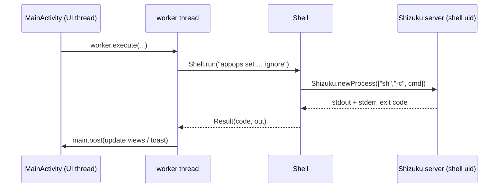

# Architecture

How TinyKit is built, and why it's about 110 KB with a single dependency. Read this before
changing the code.

## Contents

- [Design principles](#design-principles)
- [Project layout](#project-layout)
- [How a command runs](#how-a-command-runs)
- [Privilege model](#privilege-model)
- [app_process helpers](#app_process-helpers)
- [Restore after a restart](#restore-after-a-restart)
- [UI](#ui)
- [Threading](#threading)
- [Memory](#memory)
- [Quick Settings tiles](#quick-settings-tiles)
- [State and storage](#state-and-storage)
- [Network access](#network-access)
- [Build and release](#build-and-release)

## Design principles

These are the rules the code follows. Changes should keep them.

1. **Nothing in the background.** No services that keep running, no alarms, no jobs, no
   receivers waiting for system events. TinyKit runs only while it's on screen or while a tile
   or the widget is being tapped. The one exception is when Shizuku starts: it starts TinyKit's
   process, which spends a second or two putting back what a restart wiped (see
   [Restore](#restore-after-a-restart)) and then idles.
2. **Only Android's own mechanisms.** Every change is a `settings` key, an app-op, a package
   manager call or a system service call that `adb shell` could make. No patching, no root, no
   Xposed.
3. **Everything is reversible** from the same screen that made the change.
4. **Small.** One dependency (the Shizuku API), no AndroidX, no XML layouts, no image assets
   except vector icons.
5. **Plain language.** UI text says what will happen, in everyday words, and errors say what
   to do next.

## Project layout

```text
tinykit/
├── app/
│   ├── build.gradle.kts            App module: SDK levels, signing, R8, dependencies
│   ├── proguard-rules.pro          Keeps the reflection and app_process entry points
│   └── src/main/
│       ├── AndroidManifest.xml     Activity, 16 tile services, Shizuku provider
│       ├── java/io/github/order52/tinykit/
│       │   ├── MainActivity.java   The whole UI and every tool (~4,900 lines)
│       │   ├── Shell.java          Runs shell commands through Shizuku
│       │   ├── Tweak.java          Settings toggles shared by the app and its tiles
│       │   ├── Tiles.java          14 Quick Settings tiles on one base class
│       │   ├── ShizukuTile.java    Shizuku on/off tile (token, Termux or kill)
│       │   ├── ScreenshotTile.java Screenshot tile
│       │   ├── Ram.java            Speed up phone, shared by the app, the Free RAM tile and the widget
│       │   ├── BoostWidget.java    Home screen widget: one tap frees RAM and clears caches
│       │   ├── Sensors.java        app_process helper: all-sensors privacy
│       │   ├── Firewall.java       app_process helper: block an app's internet (Android 14+)
│       │   ├── FirewallPolicy.java The saved block/allow lists and how they are applied
│       │   ├── Restore.java        Puts back the firewall and Force dark after a restart
│       │   ├── TinyKitApp.java     Application: starts Restore when Shizuku's binder arrives
│       │   ├── Bloat.java          Safety ratings for the Debloater
│       │   ├── ApkInstaller.java   Installs .apk, .apks, .xapk and .apkm through pm, streaming
│       │   ├── WifiDump.java       app_process helper: saved Wi-Fi credentials
│       │   └── Qr.java             Small QR encoder for Wi-Fi codes
│       └── res/
│           ├── drawable/           Vector icons: launcher, tiles, file and image
│           ├── mipmap-anydpi*/     Adaptive launcher icon
│           └── values/             App name and the pure black theme
├── docs/                           This documentation
├── fastlane/metadata/android/      Store listing text and changelogs (F-Droid)
├── fdroid/                         F-Droid build recipe and submission notes
├── build.gradle.kts                Root: Android Gradle Plugin version
└── settings.gradle.kts
```

`MainActivity` is organised into sections marked with `// ---- Name ----` comments: *Pages*,
*Shizuku*, *Home*, *Per-app tools*, *Running apps*, *Phone info*,
*Recover deleted files*, *Apps: permissions & app-ops*, *Quick panel editor*, *Rows and
widgets*, *Helpers* and so on. Search for the marker to jump to a feature.

## How a command runs

Almost every feature comes down to a call to `Shell.run(String)`:



`Shell.run`:

- Checks `Shell.ready()`: the Shizuku binder is alive and TinyKit has been allowed to use it.
- Calls Shizuku's `newProcess` **by reflection**. Shizuku makes it private in favour of
  `UserService`, which is far heavier for one-line commands. `proguard-rules.pro` keeps the
  method so R8 doesn't remove it.
- Runs `sh -c "exec 2>&1\n<command>"`, so stderr is merged into the output that error toasts
  show.
- Returns a `Result` with the exit `code` and trimmed `out`. Callers turn that into a user
  message with `error(Result)`, which returns `null` on success.

Values from outside TinyKit, such as package names and file paths, always go through
`Shell.quote()`, which single-quotes them safely for `sh`.

## Privilege model

| Who | Runs as | Can do |
| --- | --- | --- |
| TinyKit's process | Its own app uid | Normal app APIs, plus anything granted below |
| Shizuku server | `shell` (uid 2000) | Anything `adb shell` can: `settings`, `appops`, `pm`, `cmd`, `dumpsys`, `logcat`, read shared storage, … |
| `app_process` helpers | `shell` | Call hidden system service APIs that need shell privileges |

The first time Shizuku is ready, `Tweak.grantSelf()` runs:

```sh
pm grant io.github.order52.tinykit android.permission.WRITE_SECURE_SETTINGS
appops set io.github.order52.tinykit WRITE_SETTINGS allow
appops set io.github.order52.tinykit GET_USAGE_STATS allow
```

From then on, `Tweak.put()` writes settings through `Settings.Global/Secure/System` directly and
only falls back to Shizuku when a write is refused (Huawei locks some keys). That's why most
tiles work with Shizuku stopped.

## app_process helpers

Three features need hidden system APIs that only privileged callers may use. Rather than adding a
Shizuku `UserService`, TinyKit runs a class **from its own APK** as the `shell` user:

```sh
CLASSPATH=/data/app/…/base.apk app_process /system/bin io.github.order52.tinykit.WifiDump
```

| Class | Calls | Output |
| --- | --- | --- |
| `WifiDump` | `IWifiManager.getPrivilegedConfiguredNetworks("com.android.shell", …)`, adding an `AttributionSource` on Android 12+ | One `SSID⇥type⇥password` line per network |
| `Sensors` | `ISensorPrivacyManager.setSensorPrivacy(…)` and `isSensorPrivacyEnabled()` | `OK`, or `true`/`false` |
| `Firewall` | `IConnectivityManager.setUidFirewallRule(…)` and `getUidFirewallRule(…)` on `FIREWALL_CHAIN_OEM_DENY_3`; `sync` blocks and clears in one run | `OK`, or the blocked user IDs. It exits at once; the kernel keeps the rule. |

All three look up their service through `ServiceManager.getService` and pick the matching method by
reflection, so they keep working across Android versions with different signatures. Their
`main` methods are kept by `proguard-rules.pro`.

## Restore after a restart

Android wipes two things TinyKit sets: the firewall rules and `debug.hwui.force_dark`. When
Shizuku starts it starts the processes of apps that use it, and `TinyKitApp` (the `Application`)
listens for Shizuku's binder arriving. `Restore` then runs once per boot, tracked by
`Settings.Global.BOOT_COUNT`:

- `FirewallPolicy.apply` pushes the saved choice in one `Firewall sync` run (nothing to do if no
  app is blocked), and
- Force dark is switched back on if it was on.

The process then idles like any cached app. TinyKit keeps no service and no receiver. The
firewall choice lives in `SharedPreferences` (`fw_blocked`, `fw_allowed`, `fw_allow_mode`).
`FirewallPolicy` reads user IDs from `PackageManager` instead of `pm list packages -U`, which
saves a shell call each time.

## UI

- **No XML layouts.** Every screen is built in code from a few helpers in the *Rows and widgets*
  section: `row`, `link`, `toggle`, `privacySwitch`, `action`, `section`, `note`, `sortBar`,
  `button`, `text`. This keeps the APK small and every screen consistent.
- **Shizuku-only rows** pass `needsShizuku = true` to `row()`. While Shizuku isn't usable they
  are dimmed and show a **Requires Shizuku** label, and tapping them explains why. Rows that
  work without Shizuku (or degrade gracefully) pass `false` and always look normal.
- **Navigation** is a simple page stack: `push(title, view)` adds a page, Back pops it, and the
  five bottom tabs reset the stack. There are no fragments.
- **Lists** use one generic `Adapter<T>` with a `Binder<T>` lambda, and app icons are loaded
  lazily.
- **Theme**: `android:Theme.Material` with a pure black background (`#000000`), accent `#8C9EFF`,
  and green/blue/red for Real/Fake/Off.

## Threading

| Executor | Size | Used for |
| --- | --- | --- |
| `worker` | 1 thread | Every shell command and state read, in order |
| `thumbs` | 3 threads | App icons, recovery thumbnails, preloading the installed-app list |
| `main` (Handler) | UI thread | All view updates |

Using a single worker serialises the shell commands, so a change and the re-read that follows it
can't overlap. Tiles have their own single-thread executor.

## Memory

- The installed-app list is loaded once (labels are the slow part) and shared by every picker.
- App icons (up to 128) and thumbnails (up to 96) are kept in small LRU bitmap caches.
- `onTrimMemory(TRIM_MEMORY_UI_HIDDEN)` clears both caches as soon as TinyKit leaves the screen.

## Quick Settings tiles

`Tiles` is an abstract `TileService` with two hooks, both run on its worker thread:

```java
abstract Object[] state();          // {Boolean active, String subtitle}
abstract void tap(boolean active);  // change it
```

`Tiles.Toggle` wraps a `Tweak` enum value, so a settings tile is about five lines. Tiles are
*passive* (bound only while the panel is open), except `ShizukuTile`, which is *active* because
EMUI never binds passive tiles for state updates. It refreshes itself when Shizuku's binder
arrives or dies.

## State and storage

TinyKit keeps almost no state of its own. The system is the source of truth, and every screen
re-reads it.

| Store | Contents |
| --- | --- |
| `SharedPreferences("tinykit")` | Last tab, apps blocked from the internet (re-applied after a restart), Shizuku auth token, previous Private DNS (to restore it), Caffeine's previous timeout, notification filter, known quick panel tiles, original panel layout, icon setting |
| Android | Everything else: settings, app-ops, permissions, disabled packages, roles |

## Network access

TinyKit declares `INTERNET` for two features, both of which run only when you use them:

| Feature | Endpoint | When |
| --- | --- | --- |
| Check for updates | `api.github.com/repos/Order52/tinykit/releases/latest` | When you tap it, or when TinyKit opens if *Check for updates on start* is on (at most hourly, one popup per version) |
| Network info → Public IP | `api.ipify.org`, falling back to `ifconfig.me/ip` | Each time the page opens |

There are no analytics, crash reporting or ads. See [Privacy & security](privacy-and-security.md).

## Build and release

- Java 11 source, compile and target SDK 34, min SDK 24.
- Release builds use R8 (`isMinifyEnabled`, `isShrinkResources`). `buildConfig` is off.
- Signing comes from `keystore.properties`, falling back to the debug key.

See [Building](building.md) for the commands.
