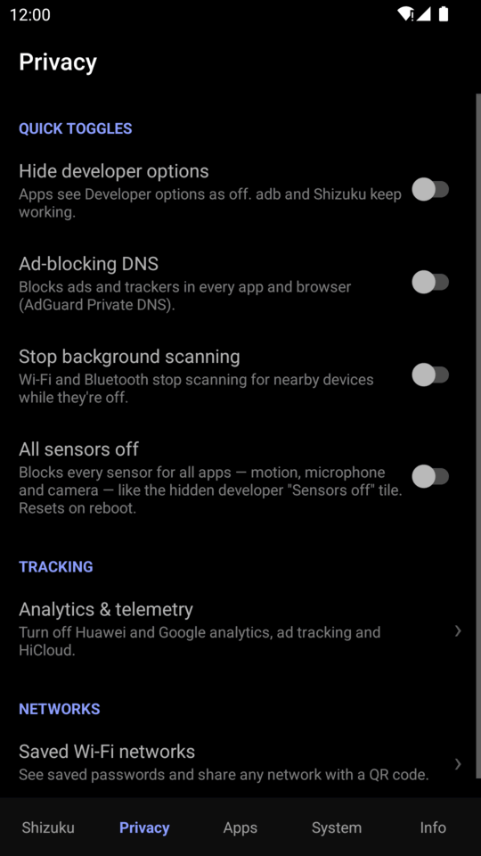
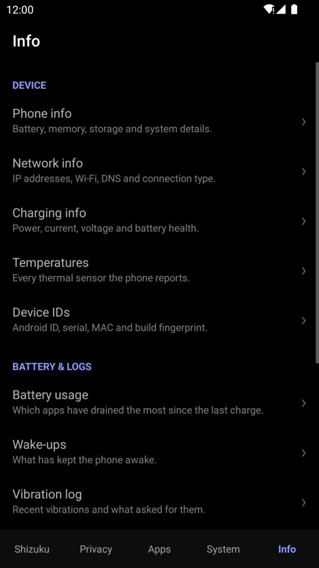

# Feature reference

Every tool in TinyKit, tab by tab: what it does, how it does it, and anything to watch out for.
Commands are shown so you can see exactly what TinyKit changes. They all run as the `shell`
user through Shizuku. `<pkg>` stands for an app's package name.

> **Legend**: ♻️ survives a reboot · ⟲ resets on reboot · 📶 uses the internet ·
> 🔓 works without Shizuku

## Contents

- [Shizuku tab](#shizuku-tab)
- [Privacy tab](#privacy-tab)
- [Apps tab](#apps-tab)
- [System tab](#system-tab)
- [Info tab](#info-tab)
- [Files TinyKit writes](#files-tinykit-writes)

---

## Shizuku tab


### Status, Start and Stop

Shows whether Shizuku is installed, running, and allowed for TinyKit, with one button for
whatever comes next: **Get Shizuku**, **Allow** or **Open Shizuku**.

Start and Stop work with the standard Shizuku app and with forks such as thedjchi's:

- **Start** uses Shizuku's auth token if one is saved and your Shizuku has a start intent
  (`moe.shizuku.privileged.api.START` broadcast, in thedjchi's fork). Otherwise it uses Termux
  (`shizuku start` via Termux's `RUN_COMMAND` service). It gives up after 60 seconds and shows
  Termux's error if something went wrong. Without Termux or shizuku-termux, it opens Shizuku
  so you tap its own **Start** button, and TinyKit connects by itself once Shizuku is running.
  That's the only way to start the standard Shizuku app without root or a computer.
- **Stop** uses the token (`…STOP` broadcast) on forks that have it. With the standard app it
  ends `shizuku_server` straight away. On forks without a saved token it asks first, because
  their Watchdog may start Shizuku again.

See [Getting started → Starting Shizuku from TinyKit](getting-started.md#starting-shizuku-from-tinykit).

### Auth token

Stores Shizuku's start/stop token in TinyKit's private preferences. **Clear** removes it.

### Quick Settings

Shortcuts to add the [Shizuku](quick-settings-tiles.md#shizuku) and
[Screenshot](quick-settings-tiles.md#screenshot) tiles. **Install Shizuku & Termux** links to the
recommended downloads: thedjchi's Shizuku, Termux from F-Droid and the original Shizuku.

### Search

The search bar above the tab searches every tool (46 of them) by title and description. Every word you type
has to match. Results open the tool directly, or switch to the tab where an inline switch lives.

<br clear="right">

---

## Privacy tab



### Quick toggles

| Toggle | What it does | Command | |
| --- | --- | --- | --- |
| **Hide developer options** | Apps that check whether developer options are on (banking apps, some games) see them as off. `adb` and Shizuku keep working. | `settings put global development_settings_enabled 0` | ♻️ |
| **Ad-blocking DNS** | Sets Private DNS to AdGuard, which blocks ads and trackers in every app and browser. Turning it off restores your previous Private DNS setting. | `settings put global private_dns_mode hostname` and `settings put global private_dns_specifier dns.adguard-dns.com` | ♻️ |
| **Stop background scanning** | Wi-Fi and Bluetooth stop scanning for nearby devices while they're turned off. This saves battery and limits location tracking. | `settings put global wifi_scan_always_enabled 0` and `settings put global ble_scan_always_enabled 0` | ♻️ |
| **All sensors off** | Blocks every sensor for all apps (motion, microphone and camera), like the hidden developer *Sensors off* tile that some manufacturers remove. | `ISensorPrivacyManager.setSensorPrivacy(true)` via `app_process` | ⟲ |

**All sensors off** has no `settings` key, so TinyKit runs a small helper class from its own APK
(`Sensors`, started with `app_process` as the `shell` user) that calls the system's sensor
privacy service directly. See [Architecture](architecture.md#app_process-helpers).

<br clear="right">

### Analytics & telemetry

Each item is a switch. *Blocked* stops the service, and turning the switch off restores it.
Items that don't apply to your phone are greyed out with *Not on this phone*.

| Item | What it does |
| --- | --- |
| **User Experience Programme** (Huawei) | `settings put secure user_experience_involved 0` and `hw_app_analytics_state 0` |
| **Diagnostics & telemetry** (Huawei) | Disables (`pm disable-user`) installed packages whose names match `com.huawei.hiview`, `hiviewtunnel`, `huawei.android.chr`, `hwdetectrepair`, `hwdiagnosis`, `recsys` or `huawei.magazine` |
| **HiCloud** (Huawei) | Disables packages matching `hicloud` |
| **Limit ad personalisation** (Google) | `settings put secure limit_ad_tracking 1` |

> [!IMPORTANT]
> Any package containing `hwid` is always skipped, so your **Huawei ID sign-in is never
> touched**.

### Block internet per app

Pick apps and cut them off **Wi-Fi and mobile data**. Needs **Android 14 or newer**.

TinyKit sets the rule once, through Android's own per-app firewall (the same kernel-level rule
Data Saver and Battery Saver use), and then does nothing. There's no VPN, no service and no
background work: Android enforces the block in the network stack, so it holds even when TinyKit
is closed or Shizuku is stopped, and it costs no memory or CPU. The rule uses one of Android's
`OEM_DENY` firewall chains, which no system feature uses, and leaves Doze and Data Saver alone.

- Changes take effect at once. Apps that were connected lose their connection.
- It blocks every network at the same time; Android has no per-app switch for Wi-Fi only or
  mobile data only.
- Android clears these rules when the phone restarts. TinyKit remembers your choices and puts
  them back the next time you open it, so after a restart the apps stay online until then.
- Apps from one developer can share an ID and are blocked together. TinyKit tells you which.
- Parts of Android itself (shared system ID) can't be blocked on their own, which protects
  you from cutting off the system by accident.

```sh
# what the helper calls (as the shell user, via app_process)
IConnectivityManager.setUidFirewallRule(FIREWALL_CHAIN_OEM_DENY_3, uid, DENY)
```

### Clipboard guard

Checked apps can't read what you copy, even while they're open. Android already stops apps from
reading the clipboard in the background, so this closes the rest. Don't check your keyboard, or
its paste suggestions stop working. ♻️

```sh
appops set <pkg> READ_CLIPBOARD ignore   # unchecking sets it back to default
```

### Saved Wi-Fi networks

Lists every saved network with its security type and password, with search. Tap a network to
see a **QR code** that any phone camera can scan to join, and a **Copy password** button.

Android only lets privileged callers read saved Wi-Fi credentials. TinyKit runs a helper class
(`WifiDump`) as the `shell` user that calls `IWifiManager.getPrivilegedConfiguredNetworks`. The
QR code is generated on the device by TinyKit's own encoder (`Qr.java`), so no library and no
network are involved.

---

## Apps tab


App lists open instantly (the installed-app list is preloaded at launch), and have search, a
**Show system apps** checkbox and a **Sort** chip. In multi-select lists, checked apps stay on
top.

### App permissions: Real / Fake / Off

Set every sensitive permission and hidden app-op per app. **Fake** shows the app the permission
as granted while it gets nothing. This is TinyKit's flagship feature, with its own guide:
**[Fake permissions →](fake-permissions.md)**

<br clear="right">

### Default apps

**Roles**: launcher, browser, phone, SMS and assistant. Shows the current holder and lets you
pick a new one.

```sh
cmd role add-role-holder android.app.role.BROWSER <pkg>
```

To read the current holder, TinyKit tries `cmd role get-role-holders` first and falls back to
`dumpsys role` on EMUI.

**File types**: PDF, images, video, audio, plain text, HTML, ZIP, EPUB, Word, Excel, Markdown
and CSV. Shows the current default (`cmd package resolve-activity`) and every app that can open
that type. Android only lets the system pin a file-type default, so set one by opening a file and
choosing **Always**.

### Hide apps

Checked apps are **disabled**. They disappear from the launcher and can't run until you uncheck
them. ♻️

```sh
pm disable-user --user 0 <pkg>   # hide
pm enable <pkg>                  # show again
```

On EMUI, disabling is the only method that reliably hides an app.

### Unused apps

Launchable apps sorted from longest unused, with *Last opened 3 months ago* or *Never opened*.
Uses `UsageStatsManager` over the last year. Tap an app to open its system settings, where you
can uninstall it.

### Storage by app

App, data and cache size for every installed app (`StorageStatsManager`), largest first, with a
total. Tap an app to open its settings.

### Recent access

Which apps recently used the **camera, microphone, location, contacts or clipboard**, and when,
newest first. TinyKit parses `dumpsys appops`, so it's best-effort and varies a little between
phones.

### Mixed audio

Tap an app to choose:

| Action | Command | Effect |
| --- | --- | --- |
| **Let it play with others** | `appops set <pkg> TAKE_AUDIO_FOCUS ignore` | The app no longer pauses other audio. Play music and a video together, or keep a podcast going during a game. |
| **Mute audio** | `appops set <pkg> PLAY_AUDIO deny` | The app is silent. |

Android's audio system enforces both, so nothing runs in the background. ♻️

### Running apps

Everything running, with its memory use (from `dumpsys meminfo`), sorted by memory or name, and
a used/total RAM summary. Tap an app to stop it (`am force-stop`). Persistent system processes
can't be stopped and are labelled as such.

### Stop background activity

Checked apps are restricted the same way as in Settings → Battery → *Restricted*: no background
work, alarms or wake locks until you open them, and Android moves them to its lowest standby
priority:

```sh
am set-standby-bucket <pkg> restricted     # Android 9+; unchecking sets it back to active
appops set <pkg> RUN_ANY_IN_BACKGROUND ignore
appops set <pkg> WAKE_LOCK ignore
```

Notifications from checked apps may arrive late, so leave messengers unchecked. Android never
restricts some system components, so a checked system app may keep its standby priority. ♻️

### Keep apps alive

The opposite: checked apps are exempt from battery optimisation and background limits, so
Android won't kill them or delay their notifications. This is useful for Termux, messengers and
Shizuku itself. ♻️

```sh
dumpsys deviceidle whitelist +<pkg>
appops set <pkg> RUN_ANY_IN_BACKGROUND allow
appops set <pkg> WAKE_LOCK allow
```

### Install APK files

Installs `.apk` files, and apps that come in several parts: `.apks`, `.xapk`, `.apkm`, or
several `.apk` files picked together in the file picker. It uses Android's own package
installer through Shizuku, so there's no per-install "Install unknown apps" prompt.

- **Streams, doesn't unpack.** Each part is piped into the install session straight from the
  file, so a big game isn't copied or extracted first. (A file that can't be opened in place,
  such as one on cloud storage, is copied to the cache once and deleted afterwards.)
- **Installs only what this phone needs:** the base, feature splits, the processor splits that
  match your phone, your screen density and your languages.
- **Game data.** `.xapk` files with `Android/obb/<package>/*.obb` get it copied to
  `Android/obb/<package>`.
- **Updates over an installed app** with the same signing key. Android won't install an older
  version over a newer one, or an app signed with a different key; TinyKit says so in plain
  words and what to do.
- Old apps that Android 14 would normally refuse (built for Android 5 and older) are allowed.

```sh
pm install-create -r -S <bytes>              # one session
pm install-write -S <bytes> <id> pN.apk -    # each part, from stdin
pm install-commit <id>
```

### Back up app as APK

Copies any app's APK to `Download/TinyKit/<App>-<version>.apk`. Split APKs (App Bundles) are
copied into a folder, and all the files in it must be installed together, for example with SAI
or `adb install-multiple`.

---

## System tab


### Display

| Setting | What it does | |
| --- | --- | --- |
| **Force dark on all apps** | Turns on Android's built-in force-dark for apps that have no dark mode. Each app picks it up when it's next opened. Uses `setprop debug.hwui.force_dark true`, plus the OEM keys `op_force_dark_entire_world` and `aosp_force_dark_mode` where they exist. | ⟲ |
| **Animation speed** | Off, 0.5×, 1×, 1.5× or 2×. Sets `window_animation_scale`, `transition_animation_scale` and `animator_duration_scale` together. | ♻️ |
| **Show app icons** | Shows real app icons in lists. Turn it off for the lowest memory use on very long app lists. A TinyKit preference. | ♻️ |

<br clear="right">

### Quick panel

**Edit quick panel** is a visual editor for the system's Quick Settings panel, laid out like
the real thing: round tiles on EMUI, wide tiles on stock Android 12+, with pages.

- **Drag** a tile to move it (hold it over a page arrow to turn the page), or tap two tiles to
  swap them. A picked tile also gets **Earlier**, **Later** and **Remove** buttons.
- **Add**: every tile not already in your panel, including built-in tiles, TinyKit's tiles and
  other apps' tiles. Tap one to add it to the end.
- **Restore original layout** puts back the panel exactly as it was before you first used the
  editor.
- Every change is written to the `sysui_qs_tiles` secure setting, which SystemUI applies
  immediately. If a write fails, the previous order comes back. Phones that don't allow this
  say so.

**TinyKit tiles** lists all 16 of TinyKit's tiles with an **Add** button each. See
[Quick Settings tiles](quick-settings-tiles.md).

### Tools

**Run a command** runs any shell command as the `shell` user and shows its output and exit
code. It's handy for checking what TinyKit did:

```sh
appops get <pkg>
settings list global
getprop ro.product.model
```

**Recover deleted files** searches every recycle bin and trash folder on shared storage in a
single `find` pass:

| Location | Source |
| --- | --- |
| `*/.Gallery2/recycle/*` | Huawei Gallery's recycle bin. File names are decoded from Base32 metadata back to the real name. |
| `*/.File_Recycle/*` | Huawei Files' recycle bin |
| `*/.fvTrash/*` | Other gallery and file manager trash |
| `.trashed-*` | Android 11+'s MediaStore trash |
| `*/.thumbnails/*` | Thumbnail caches. These often hold a small copy of photos that are long gone. |
| `*/LOST.DIR/*` | Fragments recovered by a file system check |

Results show thumbnails (decoded through Shizuku, since apps can't open trash folders
directly) and can be sorted by size, date or name. Tapping **Restore** *copies* the file to
`Download/TinyKit/Recovered`, and the original stays in the bin.

**Settings backup & restore** saves every `global`, `secure` and `system` setting to
`Download/TinyKit/settings-<date>.txt` (`settings list`). **Restore** lists your backups,
newest first, and writes each key back with `settings put`. Read-only keys are skipped, and
some changes need a restart.

> [!CAUTION]
> Restoring a backup from a different phone or Android version can apply settings that don't
> suit it. Restore on the device the backup was made on.

**Advanced reboot** offers four modes, each confirmed first:

| Option | Command |
| --- | --- |
| Reboot | `svc power reboot` |
| Reboot to recovery | `svc power reboot recovery` |
| Reboot to bootloader | `svc power reboot bootloader` |
| Soft reboot | `svc power reboot userspace`. This restarts Android without restarting the kernel (Android 11+; older versions do a normal reboot). |

### Clean & speed

| Action | Command | Notes |
| --- | --- | --- |
| **Free up RAM** | `am kill-all`, then `cmd activity send-trim-memory <process> MODERATE` (or `RUNNING_LOW`) for each app still running | See below. Works without Shizuku on Android 13 and older. |
| **Clear all app caches** | `pm trim-caches 999G` | Reports how much space came back |
| **Optimize apps** | `cmd package bg-dexopt-job` | Compiles apps ahead of time so they open faster. Runs for about 10 minutes and keeps going if you close TinyKit. |
| **Trim storage** | `sm fstrim; sm idle-maint run` | Storage maintenance and TRIM |

**Free up RAM** does what Android itself does when memory runs low, so it's safe to use any
time:

1. It closes only the apps Android has already marked as **cached**: apps you left a while ago
   that Android keeps around in case you come back. The app on screen, music, navigation,
   anything showing a notification and anything running a service are never touched.
2. It asks every app that's still running to release its own caches, sending the same
   signals Android sends when memory runs low: `TRIM_MEMORY_MODERATE` to background apps, and
   `TRIM_MEMORY_RUNNING_LOW` to apps in use, which only free what they can rebuild. All apps
   get the signal at once, so it takes about two seconds. SystemUI is left alone so the status
   bar never redraws.

It's built to behave the same from Android 7 to the newest version and on every brand: it only
uses commands every Android has, and measures memory and storage through Android's own APIs
instead of reading command output, which differs between versions and manufacturers.

The result shows how much memory came back, how many cached apps were closed, and how much is
free now, for example *"Freed 82 MB and closed 10 cached apps. 1.9 GB free now."* Closed apps
open normally next time, just without their last screen.

Without Shizuku, on **Android 13 and older**, TinyKit does step 1 with the regular
`killBackgroundProcesses` API (step 2 needs Shizuku). Android 14 limited that API to an app's
own processes, so on Android 14 and newer the row shows **Requires Shizuku**.

> [!NOTE]
> Android is designed to keep memory full, so freed memory fills up again over time. Free up
> RAM helps most right before a heavy game or app, or when the phone feels sluggish after many
> apps were opened.

**Speed-up widget** puts this on your home screen. One tap runs **Free up RAM** and **Clear all
app caches** together without opening TinyKit, and the widget then shows the result, for
example *"Freed 61 MB RAM + 3 MB cache · 1.8 GB free"*. Tap **Speed-up widget** in this section
to place it (Android 8+), or add it from your launcher's widget list. Without Shizuku it frees
RAM only (Android 13 and older) and says that clearing caches needs Shizuku. The widget never
updates on its own and runs nothing until you tap it.

### Network & battery

| Toggle | What it does | Command |
| --- | --- | --- |
| **Free hotspot** | Hotspot uses your normal data connection instead of a separate "tethering" APN, so carriers that block or meter tethering can't tell. Works on many carriers. | `settings put global tether_dun_required 0` (off: `settings delete …`) |
| **Mobile data off on Wi-Fi** | Doesn't keep mobile data connected while on Wi-Fi. Saves battery. | `settings put global mobile_data_always_on 0` |

---

## Info tab



### Device

| Page | Shows |
| --- | --- |
| **Phone info** 🔓 | Battery charge, health, temperature, voltage, current, design and learned capacity, charge cycles; RAM and storage; model, Android version, security patch, build, kernel, processor and ABIs, uptime |
| **Network info** 🔓 📶 | Connection type and speed; SSID, signal, link speed and band; interface, IP addresses, gateway, DNS servers, Private DNS; **Open router settings** (opens `http://<gateway>`); **public IP** |
| **Charging info** 🔓 | Status, power source, charge, health, voltage, current, **watts**, temperature, technology, capacity |
| **Temperatures** 🔓 | Every thermal zone in `/sys/class/thermal`, plus the battery |
| **Device IDs** 🔓 | Android ID, serial number, Wi-Fi MAC, build fingerprint, bootloader, baseband. For the IMEI, TinyKit tells you to dial `*#06#`. |

Local network details appear instantly. Only the public IP is fetched, from `api.ipify.org`
with `ifconfig.me` as a fallback, and only while you have the page open.

<br clear="right">

### Battery & logs

| Page | Source | Shows |
| --- | --- | --- |
| **Battery usage** | `dumpsys batterystats --charged` | Estimated mAh per app and component since the last full charge, highest first |
| **Wake-ups** | `dumpsys batterystats --charged` | Partial wake locks: which app held one, for how long and how often |
| **Vibration log** | `dumpsys vibrator_manager` | Recent vibrations: which app, what kind and when |
| **App log** | `logcat --pid` | Up to 500 lines of one app's recent log output. Huawei hides most app logs. |
| **Crash log** | `logcat -b crash` | Every crash since boot, with stack traces. **Clear** empties the log. |

### Notification history

Saves notifications and their text so you can read them after they're dismissed, for example a
message that was deleted, or a code you swiped away.

- Grouped by app with a count and the newest message. Tap an app to see all of its notifications,
  newest or oldest first. Tap a notification to read the whole text, **Copy** it, or open the
  app's info.
- Searches app names and notification text.
- **Apps to save**: all apps, only chosen apps, or all apps except chosen ones.
- Stores up to 3,000 notifications, oldest dropped first, in a private file only TinyKit can
  read. **Clear saved notifications** deletes everything, and each app's page can delete just
  that app's notifications.
- On Android 11+, a switch turns on **Android's own 24-hour notification history**
  (`notification_history_enabled`), which records even while TinyKit is closed.

> [!NOTE]
> TinyKit never runs in the background, so it saves whatever is in your notification shade
> **each time you open this page**. Open it before clearing your notifications. For complete
> coverage, turn on Android's 24-hour history as well.

It reads `dumpsys notification --noredact` (the full text, not the lock-screen copy), skips
ongoing notifications and group summaries, and removes duplicates.

### Check for updates 📶

Asks the GitHub API for the latest TinyKit release when you tap it, and offers the APK download
if there's a newer version.

**Check for updates on start** (off by default) does the same check each time you open TinyKit,
at most once an hour, and shows an "Update available" popup when a new version is out. You get
one popup per version, never repeats. No notification permission is needed. Nothing checks while TinyKit is closed.

### About

Version, author, licence and a link to the source code.

---

## Files TinyKit writes

| Path | What | Written by |
| --- | --- | --- |
| `Download/TinyKit/<App>-<version>.apk` | APK backups | Back up app as APK |
| `Download/TinyKit/settings-<date>.txt` | Settings backups | Settings backup & restore |
| `Download/TinyKit/Recovered/` | Restored files | Recover deleted files |
| `Pictures/Screenshots/Screenshot_<date>_TinyKit.png` | Screenshots | Screenshot tile |
| `Movies/Screen_<date>_TinyKit.mp4` | Recordings | Screen record tile |
| App-private `notifications.tsv` | Saved notifications | Notification history |
| App-private `shared_prefs/tinykit.xml` | Preferences: last tab, auth token, previous DNS, filters | Everything |

TinyKit sets `allowBackup="false"`, so its private files are never copied off the device by
Android's backup.
