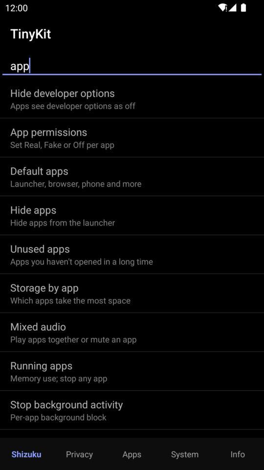

# Getting started

This guide takes you from nothing installed to TinyKit running in about five minutes.

## Contents

- [What you need](#what-you-need)
- [1. Install Shizuku](#1-install-shizuku)
- [2. Start Shizuku](#2-start-shizuku)
- [3. Install TinyKit](#3-install-tinykit)
- [4. First run](#4-first-run)
- [Starting Shizuku from TinyKit](#starting-shizuku-from-tinykit)
- [What works without Shizuku](#what-works-without-shizuku)
- [Finding your way around](#finding-your-way-around)

## What you need

| | |
| --- | --- |
| **Phone** | Android 7.0 (API 24) or newer. No root. |
| **Shizuku** | [thedjchi's fork](https://github.com/thedjchi/Shizuku/releases/latest) (recommended) or the [original](https://shizuku.rikka.app/download/) |
| **A way to start Shizuku** | Wireless debugging (Android 11+), a computer with `adb`, or Termux with [shizuku-termux](https://github.com/Order52/shizuku-termux) |

## 1. Install Shizuku

[Shizuku](https://shizuku.rikka.app/) runs a small background service with the same privileges
as `adb shell`. TinyKit sends its commands through that service, which is why it needs no root.

We recommend **[thedjchi's fork](https://github.com/thedjchi/Shizuku/releases/latest)**. Its
*Watchdog* restarts Shizuku if Android kills it, and it supports start and stop *intents* with an
auth token, which TinyKit can use (see [below](#with-the-auth-token)). The standard Shizuku from
[shizuku.rikka.app](https://shizuku.rikka.app/) works too, including TinyKit's **Start** and
**Stop** buttons (see [below](#with-the-standard-shizuku-app)).

## 2. Start Shizuku

Shizuku has to be started again after every reboot. Choose whichever method suits you:

### Option A: Wireless debugging (Android 11+, no computer)

1. Turn on **Developer options**: open *Settings → About phone* and tap *Build number* seven times.
2. Open Shizuku and tap **Pairing**, then follow its step-by-step guide to pair with
   *Wireless debugging*.
3. Tap **Start** in Shizuku.

### Option B: A computer with adb

```sh
adb shell sh /sdcard/Android/data/moe.shizuku.privileged.api/start.sh
```

Shizuku shows the exact command for your version under *Start by connecting to a computer*.

### Option C: Termux (no computer, any Android version)

Install [Termux from F-Droid](https://f-droid.org/packages/com.termux/) and set up
[shizuku-termux](https://github.com/Order52/shizuku-termux) once. After that, TinyKit's **Start**
button and the **Shizuku** tile can start Shizuku for you. See
[Starting Shizuku from TinyKit](#starting-shizuku-from-tinykit).

## 3. Install TinyKit

Download `TinyKit-<version>.apk` from the
[latest release](https://github.com/Order52/tinykit/releases/latest) and open it. You may need
to allow your browser or file manager to install apps.

To build it yourself instead, see [Building](building.md).

## 4. First run

1. Open TinyKit. The **Shizuku** tab shows Shizuku's status.
2. If it says *"Shizuku is running. Allow TinyKit to use it."*, tap **Allow** and accept
   Shizuku's prompt.
3. The status changes to **Shizuku is running ✓**.

On that first connection, TinyKit uses Shizuku once to grant itself two things:

- `WRITE_SECURE_SETTINGS`, so its settings toggles and Quick Settings tiles keep working when
  Shizuku is **not** running.
- The `GET_USAGE_STATS` app-op, used by **Unused apps** and **Storage by app**.

Both are standard grants that any `adb shell` can make. They show up in Android's own records,
and uninstalling TinyKit removes them.

## Starting Shizuku from TinyKit

The **Shizuku** tab has **Start** and **Stop** buttons, and there is a one-tap
[Shizuku tile](quick-settings-tiles.md#shizuku). The buttons work with the standard Shizuku app
and with forks. **Start** tries these in order:

1. The [auth token](#with-the-auth-token), if one is saved and your Shizuku has start intents.
2. [Termux](#with-termux), if it's installed.
3. Otherwise it [opens Shizuku](#with-the-standard-shizuku-app) so you tap its own Start button.

### With the auth token

thedjchi's fork can be started and stopped with an intent carrying a secret token.

1. In Shizuku, open *Settings* and find the start/stop intent parameters. Copy the token.
2. In TinyKit, tap **Auth token** on the Shizuku tab and paste it.

**Start** and **Stop** then go straight to Shizuku. **Stop** also works properly with the
Watchdog on, because Shizuku knows the stop was intentional.

### With Termux

With no token saved, **Start** asks Termux to run `shizuku start` from
[shizuku-termux](https://github.com/Order52/shizuku-termux).

- The first time, Android asks you to allow TinyKit to *Run commands in Termux environment*.
  Allow it.
- If Termux says it doesn't allow external apps, run the shizuku-termux install command in
  Termux once. It sets `allow-external-apps=true`.
- If Termux is installed but shizuku-termux isn't, TinyKit opens Shizuku instead, as below.

### With the standard Shizuku app

The standard Shizuku app has no start intents, and without root or a computer it can only be
started from its own screen. So with no token and no Termux, **Start** opens Shizuku on its
**Start** button. Tap it (the first time, Shizuku walks you through pairing with Wireless
debugging), then go back: TinyKit notices Shizuku is running and connects by itself.

### Stop

- **Standard Shizuku app:** **Stop** ends Shizuku's server straight away. It has no Watchdog,
  so it stays stopped.
- **Forks with the auth token saved:** **Stop** uses Shizuku's own stop intent, which the
  Watchdog respects.
- **Forks without a token:** **Stop** asks first, then ends the server. If the Watchdog is on,
  it starts Shizuku again, so save the token if you use the Watchdog.

## What works without Shizuku

These keep working when Shizuku is stopped (the tiles thanks to the one-time self-grant):

- These Quick Settings tiles: Developer options, USB debugging, Hide dev options, Ad-block DNS,
  Grayscale, Extra dim, Screen timeout and Caffeine (the matching switches inside the app still
  need Shizuku)
- **Phone info**, **Network info**, **Charging info**, **Temperatures** and **Device IDs**
  (some show fewer details)
- Reading saved notifications in **Notification history** (saving new ones needs Shizuku)
- **Free up RAM** and the **Free RAM** tile on Android 13 and older (closing cached apps only)

Everything else needs Shizuku running: per-app tools, logs, file recovery, saved Wi-Fi networks,
and more. While Shizuku is off, those rows are dimmed and marked **Requires Shizuku**, and rows
that work without it look normal.

## Finding your way around

<p align="center">
  
  
  
</p>
<p align="center">
  
  
  
</p>

| Tab | What's there |
| --- | --- |
| **Shizuku** | Shizuku status, Start and Stop, the auth token, the Shizuku and Screenshot tiles, and the **search bar** |
| **Privacy** | Privacy toggles, all sensors off, analytics and telemetry, saved Wi-Fi networks |
| **Apps** | Fake permissions, default apps, hide, unused, storage, recent access, mixed audio, running and background apps, APK backup |
| **System** | Force dark, animation speed, quick panel editor, TinyKit tiles, run a command, file recovery, settings backup, advanced reboot, cleanup, network tweaks |
| **Info** | Phone, network, charging, temperatures, device IDs, battery usage, wake-ups, vibration, app and crash logs, notification history, updates |

The **search bar** at the top of the Shizuku tab searches every tool by name and description.
Every search word has to match, so `wifi qr` finds *Saved Wi-Fi networks*. Tapping a result
opens it.

Next: the full [feature reference](features.md), or the
[Fake permissions guide](fake-permissions.md).
