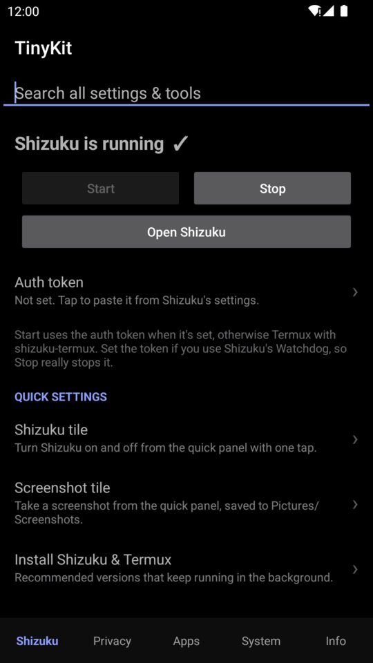
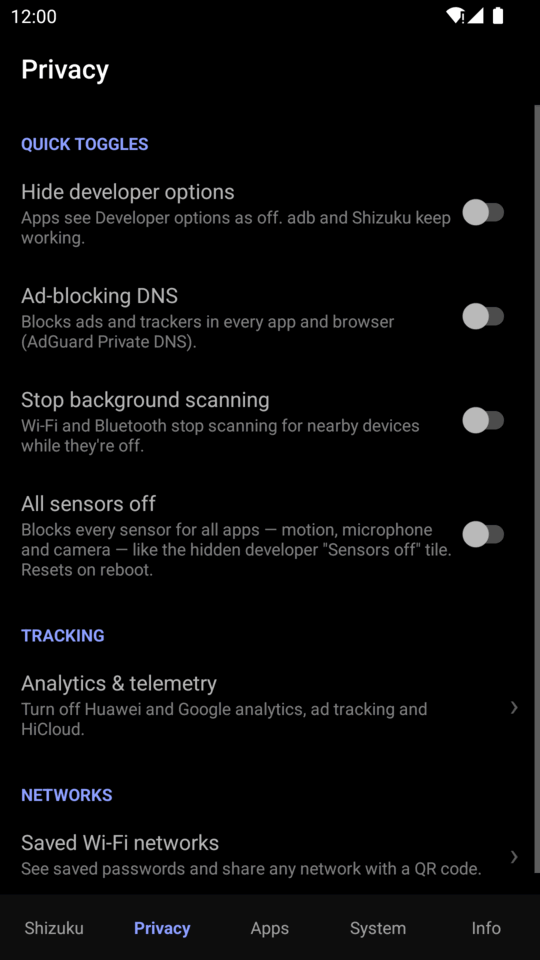
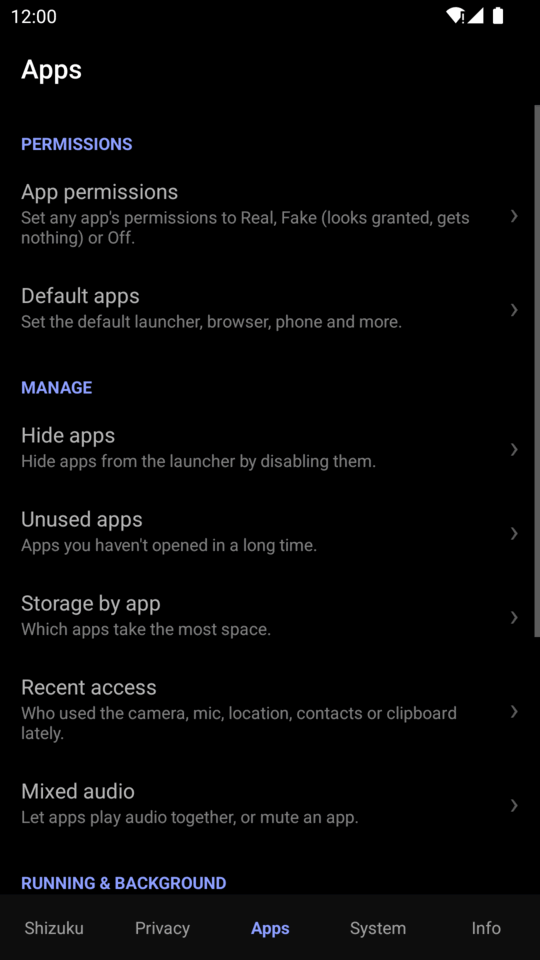
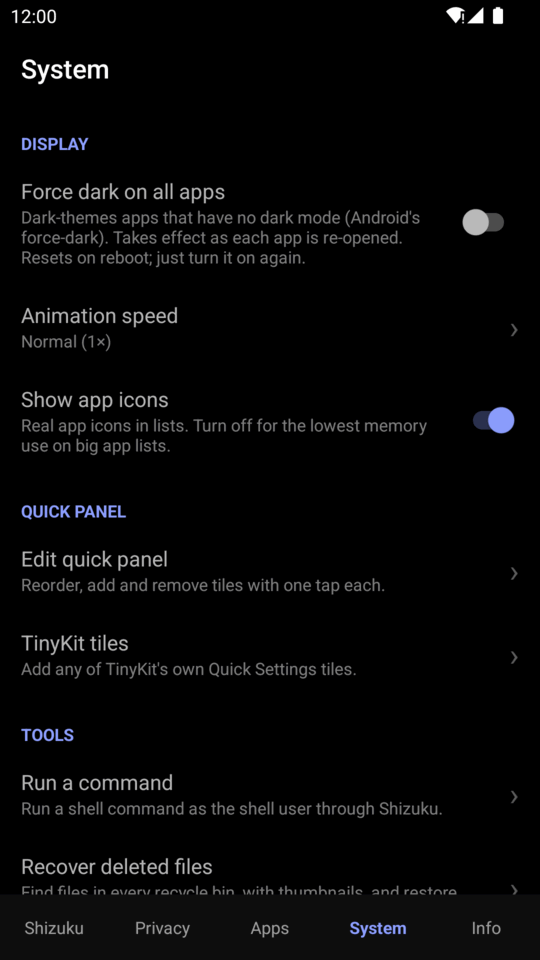
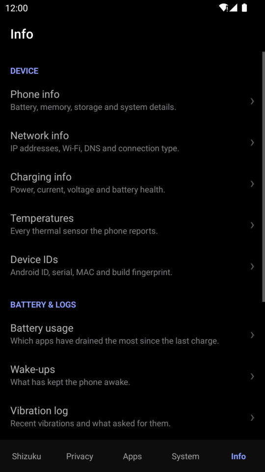
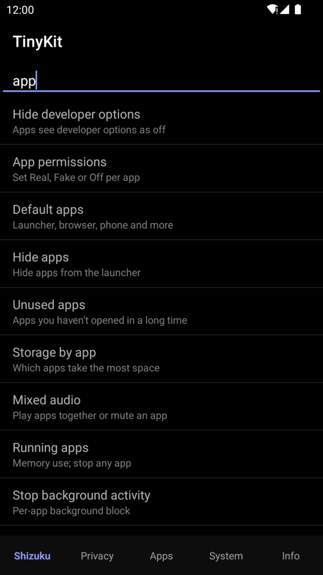

# Getting started

This guide takes you from nothing installed to TinyKit running in about five minutes.

## Contents

- [What you need](#what-you-need)
- [1. Install Shizuku](#1-install-shizuku)
- [2. Start Shizuku](#2-start-shizuku)
- [3. Install TinyKit](#3-install-tinykit)
- [4. First run](#4-first-run)
- [Starting Shizuku from TinyKit](#starting-shizuku-from-tinykit)
- [What works without Shizuku](#what-works-without-shizuku)
- [Finding your way around](#finding-your-way-around)

## What you need

| | |
| --- | --- |
| **Phone** | Android 7.0 (API 24) or newer. No root. |
| **Shizuku** | [thedjchi's fork](https://github.com/thedjchi/Shizuku/releases/latest) (recommended) or the [original](https://shizuku.rikka.app/download/) |
| **A way to start Shizuku** | TinyKit's **Start** button: Wireless debugging on Android 11+ (it pairs itself), root, or adb over the network; or a computer with `adb` |

## 1. Install Shizuku

[Shizuku](https://shizuku.rikka.app/) runs a small background service with the same privileges
as `adb shell`. TinyKit sends its commands through that service, which is why it needs no root.

We recommend **[thedjchi's fork](https://github.com/thedjchi/Shizuku/releases/latest)**. Its
*Watchdog* restarts Shizuku if Android kills it, and it supports start and stop *intents* with an
auth token, which TinyKit can use (see [below](#with-the-auth-token)). The standard Shizuku from
[shizuku.rikka.app](https://shizuku.rikka.app/) works too, including TinyKit's **Start** and
**Stop** buttons (see [below](#with-the-shizuku-app-itself)).

## 2. Start Shizuku

Shizuku has to be started again after every reboot. Choose whichever method suits you:

### Option A: TinyKit's Start button (Android 11+, nothing else to install)

Tap **Start** on the Shizuku tab (or use the Shizuku tile). TinyKit starts Shizuku itself through
Wireless debugging, with its own adb client. The first time it needs one thing Android won't let
an app do alone: a **pairing code**. TinyKit opens Developer options for you (turn on *Developer
options* first if they're off: *Settings → About phone*, tap *Build number* seven times), you
switch on **Wireless debugging**, tap **Pair device with pairing code**, and type the six digits
into TinyKit's notification. That's all. After that, **Start** needs nobody: TinyKit turns
Wireless debugging on by itself (once Shizuku has let it change that setting), connects and starts
Shizuku, also after a reboot. Wireless debugging needs Wi-Fi.

### Option B: A computer with adb

```sh
adb shell sh /sdcard/Android/data/moe.shizuku.privileged.api/start.sh
```

Shizuku shows the exact command for your version under *Start by connecting to a computer*.

## Starting Shizuku from TinyKit

The **Shizuku** tab has **Start** and **Stop** buttons, and there is a one-tap
[Shizuku tile](quick-settings-tiles.md#shizuku). The buttons work with the standard Shizuku app
and with forks. **Start** tries these in order:

1. The [auth token](#with-the-auth-token), if one is saved and your Shizuku has start intents.
2. TinyKit's [own adb start](#with-tinykits-own-adb-client): root, adb over the network, or Wireless debugging.

### With the auth token

thedjchi's fork can be started and stopped with an intent carrying a secret token.

1. In Shizuku, open *Settings* and find the start/stop intent parameters. Copy the token.
2. In TinyKit, tap **Auth token** on the Shizuku tab and paste it.

**Start** and **Stop** then go straight to Shizuku. **Stop** also works properly with the
Watchdog on, because Shizuku knows the stop was intentional.

### With Termux (set up by TinyKit)

If [Termux](https://f-droid.org/packages/com.termux/) is installed, **Start** goes through it first, in the
background (no Termux window opens), and TinyKit prepares Termux itself the first time:

1. Android asks you to allow TinyKit to *run commands in Termux*. Allow it.
2. TinyKit copies **one command** and opens Termux. Paste it (hold, **Paste**) and press Enter. It switches
   on the one Termux setting that lets other apps run commands there (`allow-external-apps`, keeping your other
   settings), makes Termux read it, installs `adb` if needed, and brings TinyKit back to the front, which then
   carries on by itself. Once only; no other repo, no folder to pick.
3. TinyKit runs its own start script in Termux (built in; no other repo). It tries, as shizuku-termux does:
   already running, root, adb over the network (port 5555), then Wireless debugging. It installs `adb`
   (`android-tools`) in Termux by itself the first time it needs it.

If Termux can't do it (not installed, not allowed, no working `adb` there), TinyKit's own adb client takes over:

### Automatic start

Once a start has worked without anyone (TinyKit is paired, or root, or Termux is set up, or the auth token is saved),
**Start by itself** (Shizuku tab, on by default) starts Shizuku again on its own after every restart and whenever
you open TinyKit with Shizuku stopped. It runs quietly: it never asks for a pairing code or shows a "turn on"
notice, and gives up after a minute and a half if Wi-Fi isn't there yet. Starts are fast too: TinyKit remembers
Wireless debugging's port and tries it first. The notices that do appear open Developer options straight on the
**Wireless debugging** switch.

### With TinyKit's own adb client

With no token saved, **Start** runs TinyKit's own adb client (`Adb.java`, no library, no Termux, no other
app). It tries, in this order, the same three ways shizuku-termux does, so it works on any Android:

1. **Root**, if the phone has it and you allow TinyKit.
2. **adb over the network**, if it is on (`adb tcpip 5555` from a computer once; it lasts until the phone
   restarts). The phone may ask you to allow USB debugging the first time.
3. **Wireless debugging** (Android 11+): it finds the service (by service discovery, and by asking each port
   when that shows nothing), switches Wireless debugging on if TinyKit may, and the first time asks for the
   pairing code in a notification (see Option A) and pairs.

Then it runs Shizuku's own starter as that user, after lifting Android 12's limit on background
processes (which would kill a Shizuku started this way within minutes). The notification says what it is
waiting for and ends by itself. Android shows *"Allow wireless debugging on this network?"* once for
each Wi-Fi network.

**Without root, Android decides the rest.** On Android 11 and newer Wireless debugging is the way in,
and the pairing code is the one thing an app can't do for you. On Android 10 and older there is no
Wireless debugging, so without root one cable session with a computer is needed (`adb tcpip 5555`), once
per restart. No app can start Shizuku with neither: Android doesn't allow it. TinyKit says so, in those words,
instead of opening Shizuku.

### With the Shizuku app itself

You can always start Shizuku from its own screen instead (its **Start** button, or its pairing guide). TinyKit
notices Shizuku is running and connects by itself.

### Stop

- **Forks with the auth token saved:** **Stop** uses Shizuku's own stop intent.
- **Otherwise:** **Stop** closes the Shizuku app first, so a Watchdog can't start Shizuku again,
  then asks Shizuku's server to end, and makes it end if it hasn't within 3 seconds.

The Shizuku tab, the Shizuku tile and Shut Up all stop Shizuku this same way.

## What works without Shizuku

These keep working when Shizuku is stopped (the tiles thanks to the one-time self-grant):

- These Quick Settings tiles: Developer options, USB debugging, Hide dev options, Ad-block DNS,
  Grayscale, Extra dim, Screen timeout and Caffeine (the matching switches inside the app still
  need Shizuku)
- **Phone info**, **Network info**, **Charging info**, **Temperatures** and **Device IDs**
  (some show fewer details)
- **Speed up phone** and the **Free RAM** tile on Android 13 and older (closing cached apps only)

Everything else needs Shizuku running: per-app tools, logs, file recovery, saved Wi-Fi networks,
and more. While Shizuku is off, those rows are dimmed and marked **Requires Shizuku**, and rows
that work without it look normal.

## Finding your way around

<p align="center">
  
  
  
</p>
<p align="center">
  
  
  
</p>

| Tab | What's there |
| --- | --- |
| **Shizuku** | Shizuku status, Start and Stop, the auth token, the Shizuku tile, and the **search bar** |
| **Privacy** | Privacy toggles, all sensors off, analytics and telemetry, saved Wi-Fi networks |
| **Apps** | Fake permissions, default apps, hide, unused, storage, recent access, mixed audio, running and background apps, APK backup |
| **System** | Force dark, disable HW overlays, animation speed, quick panel editor, TinyKit tiles, run a command, file recovery, settings backup, advanced reboot, cleanup, network tweaks |
| **Info** | Phone, network, charging, temperatures, device IDs, battery usage, wake-ups, vibration, app and crash logs, updates |

The **search bar** at the top of the Shizuku tab searches every tool by name and description.
Every search word has to match, so `wifi qr` finds *Saved Wi-Fi networks*. Tapping a result
opens it.

Next: the full [feature reference](features.md), or the
[Fake permissions guide](fake-permissions.md).
